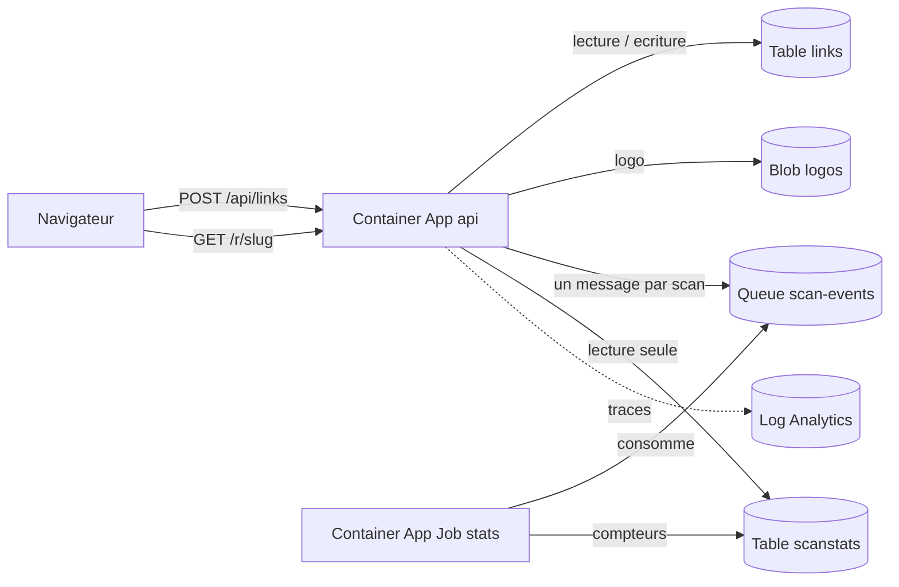

# Architecture

## Vue d'ensemble



## Pourquoi cette séparation

Tant que la résolution et les statistiques vivent dans la même requête, chaque
scan coûte une écriture en base. Une affiche dans le métro produit des milliers
de scans en quelques secondes : la latence de la redirection devient le débit
d'écriture du stockage. En déposant un message dans une file, la redirection ne
dépend plus que d'une lecture par clé et d'un envoi de message.

Le worker agrège par jour et par référent, avec une ligne de compteur par jour :
aucune ligne « total » partagée, donc pas de contention quand plusieurs instances
du job tournent.

## Cycle de vie d'un QR

1. `POST /api/links` avec l'URL cible et un style.
2. Le serveur construit le slug, rend le PNG, le décode. Si le décodage échoue
   ou si le contraste est insuffisant, la création est refusée (422).
3. Le QR encode `https://<hôte>/r/<slug>`.
4. `GET /r/<slug>` lit le lien, répond 302, dépose un message.
5. Le job agrège les messages et met à jour les compteurs.
6. `PATCH /api/links/<slug>` change la cible : le QR imprimé reste valide.

## Variante événementielle du worker

Le job est planifié toutes les deux minutes. C'est volontairement simple et sans
secret. La version événementielle utilise le scaler KEDA `azure-queue`, qui
démarre le job dès qu'un message apparaît :

```hcl
event_trigger_config {
  parallelism = 1
  scale {
    min_executions = 0
    max_executions = 3
    rules {
      name = "scans"
      custom_rule {
        type = "azure-queue"
        metadata = {
          queueName   = "scan-events"
          accountName = "stkaaruXXXX"
          queueLength = "10"
        }
        authentication {
          secret_name       = "storage-connection"
          trigger_parameter = "connection"
        }
      }
    }
  }
}
```

Le point d'attention est l'authentification : le scaler `azure-queue` attend une
chaîne de connexion. L'utiliser oblige donc à réintroduire un secret (Key Vault
+ référence), ce qui annule le bénéfice d'une architecture sans secret. C'est
pourquoi la version livrée est planifiée. Un réplica qui tourne deux minutes par
intervalle consomme moins qu'un secret stocké quelque part.

## Décisions et alternatives écartées

| Décision | Alternative écartée | Raison |
| --- | --- | --- |
| Table Storage | Cosmos DB | Une clé d'accès suffit, coût fixe quasi nul, pas de RU à calibrer |
| Container Apps | App Service | Facturation à la seconde et scale-to-zero sur le plan gratuit |
| Job planifié | Fonction Azure | Même image que l'API, moins de surface à maintenir |
| Rendu serveur + décodage | Faire confiance au client | Un style qui ne se scanne pas est un bug invisible |
| Slug 7 caractères sans ambiguïté | Identifiant séquentiel | Non énumérable et dictable au téléphone |
| Identités managées | Clés de stockage | Aucun secret à faire tourner ni à fuiter |

## Limites connues

- Pas de private endpoint : le compte de stockage reste joignable publiquement,
  mais la clé partagée est désactivée et tout passe par RBAC. Un private
  endpoint et une zone DNS privée sont la suite logique.
- Pas de rate limiting sur la création de liens : un compte anonyme pourrait en
  créer en masse. API Management ou un compteur par IP serait nécessaire.
- Le worker n'est pas idempotent à 100 % : si un message est traité puis
  relivré (timeout pendant la suppression), le compteur est incrémenté deux
  fois. Un identifiant de message stocké comme clé de ligne corrigerait cela.
