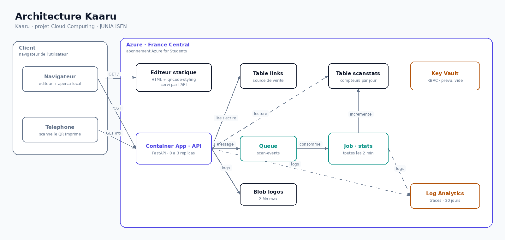
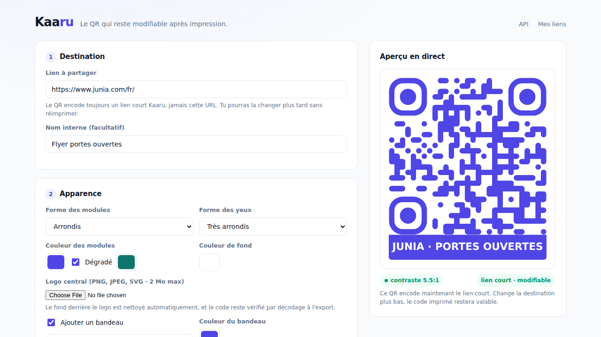
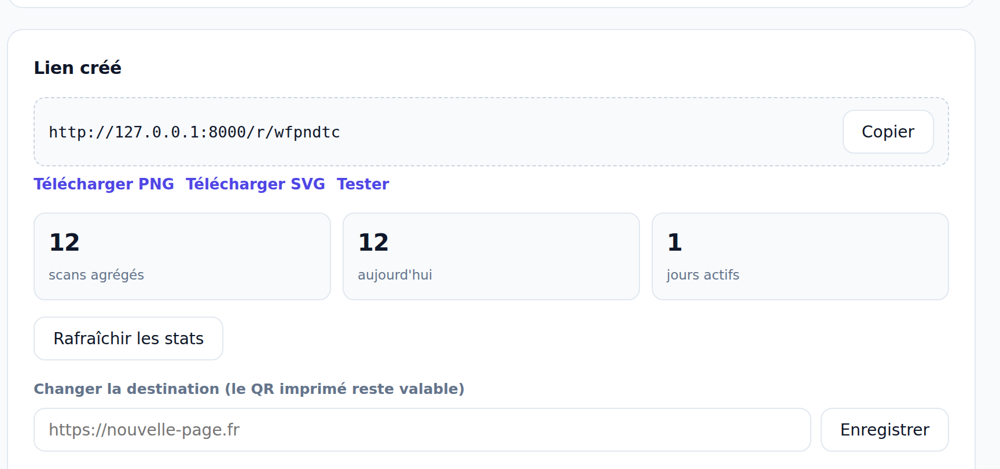
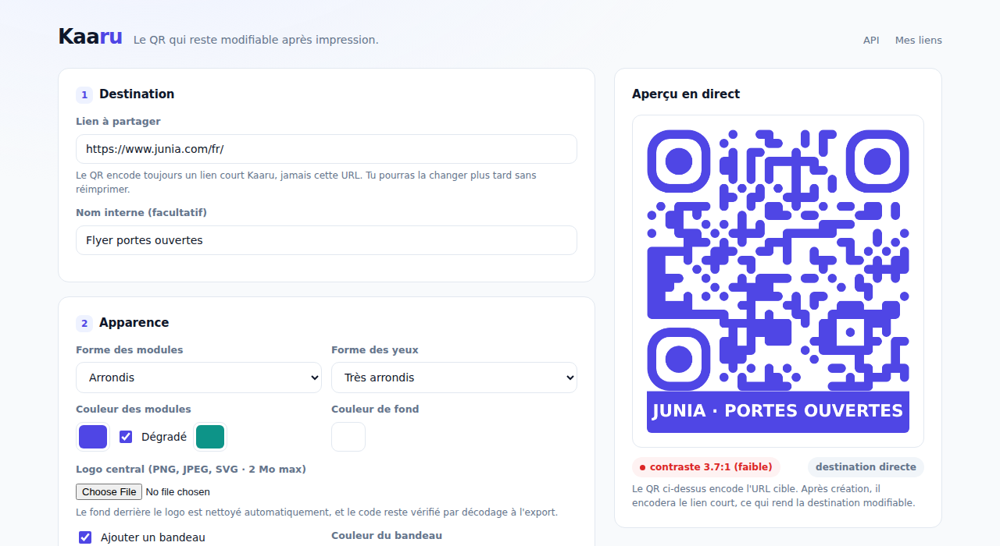
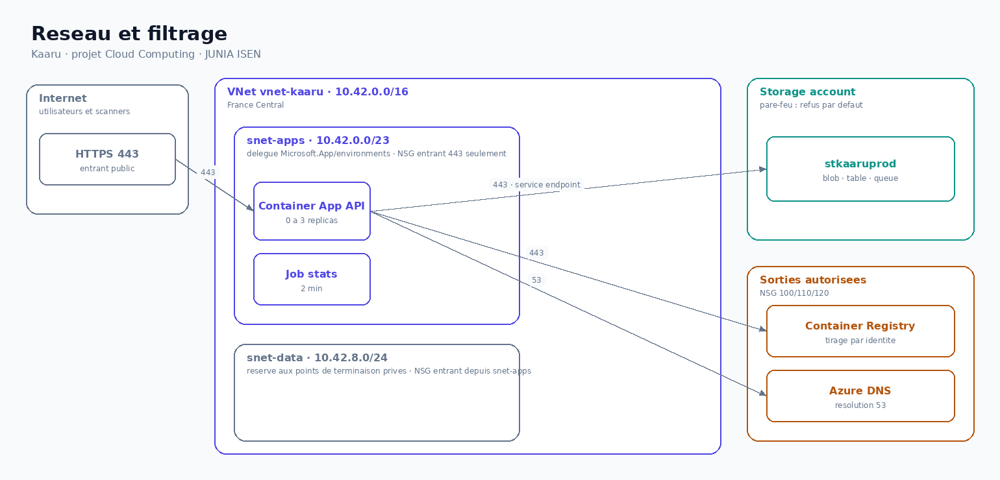

# Kaaru — QR codes dynamiques sur Azure

**Projet Cloud Computing — JUNIA ISEN, 5e année**
Paul-Victor Delerue · Louis Thepkaisone · Quentin Larouziere
Dépôts : [kaaru-api](https://github.com/zeekFPS/kaaru-api) · [kaaru-infra](https://github.com/zeekFPS/kaaru-infra)

---

## 1. Contexte et objectifs

Un QR code encode une URL, une fois pour toutes. Une page qui change d'adresse,
une campagne qui se termine, une faute dans le lien : il faut réimprimer. Sur
une affiche, un flyer ou un emballage, cela signifie refaire le support.

Kaaru part de ce constat. L'application génère un QR **personnalisable**
(couleurs, formes, dégradé, logo, bandeau) qui n'encode pas la destination mais
un **lien court** que le service contrôle. La destination devient une donnée
modifiable, et chaque scan est compté.

Objectifs du projet :

1. livrer une application fonctionnelle et accessible publiquement ;
2. la déployer entièrement par IaC, avec état distant verrouillé ;
3. respecter les exigences de la session : deux stockages, deux composants de
   calcul, réseau filtré, identités managées, supervision avec alertes ;
4. justifier chaque choix face aux alternatives.

## 2. Vue d'ensemble de l'architecture



Trois idées structurent la conception.

**Le QR est vérifié, pas supposé.** Le rendu se fait côté serveur (segno +
Pillow) puis l'image produite est **décodée** (pyzbar) avant d'être renvoyée. Si
elle ne se décode pas à pleine résolution *et* à 300 px — la taille d'une capture
de téléphone — la création est refusée avec un code 422. Le contraste WCAG est
calculé, dégradé inclus, avec un seuil de 4.5:1. Un style illisible n'est jamais
livré : c'est une propriété testée en CI, pas une intention.

**Le chemin chaud est séparé du chemin froid.** Une redirection doit répondre en
quelques millisecondes, même si une affiche génère des milliers de scans. Aussi
`GET /r/{slug}` ne fait que deux choses : résoudre le lien et déposer un message
dans une file. L'agrégation des statistiques est le travail d'un job séparé.

**Aucun secret.** Pas de clé de stockage (elle est désactivée sur le compte),
pas de mot de passe de registre, pas de chaîne de connexion. Deux identités
managées portent des droits différents, appliqués par RBAC.

### Captures de l'application



*L'éditeur. L'aperçu est rendu dans le navigateur, mais toute création repasse
par le rendu serveur et son décodage de vérification.*



*Après création : lien court, export PNG et SVG, compteurs et changement de
destination. Le QR imprimé reste valable puisque seule la cible change.*



*Le garde-fou en action : un dégradé à 3.7:1 est refusé avant même l'appel
serveur. Un joli QR qui ne se scanne pas est un QR inutile.*


### Options envisagées

| Option | Verdict | Raison |
| --- | --- | --- |
| Application monolithique avec statistiques synchrones | Écartée | Chaque scan devient une écriture en base : la latence de redirection suit le débit de stockage |
| Base relationnelle (PostgreSQL flexible) | Écartée | Coût fixe mensuel et administration pour un volume de quelques milliers de lignes |
| Cosmos DB | Écartée | Dimensionnement en RU à calibrer, coût supérieur, aucun besoin de distribution mondiale |
| App Service | Écartée | Pas de facturation à la seconde, scale-to-zero impossible sur le palier gratuit |
| AKS | Écartée | Un cluster Kubernetes pour deux conteneurs est un coût et une charge d'exploitation sans contrepartie |
| Fonctions Azure pour le worker | Écartée | Même image que l'API, un seul artefact à maintenir et à construire |

## 3. Conception du stockage

| Usage | Service | Niveau d'accès | Justification |
| --- | --- | --- | --- |
| Liens courts (`links`) | Table Storage | Privé, RBAC | Accès par clé (slug), pas de jointure, coût au Go et à l'opération |
| Compteurs (`scanstats`) | Table Storage | Privé, RBAC (écriture : worker seul) | Une ligne par lien et par jour : pas de contention sur une ligne unique |
| Événements de scan (`scan-events`) | Queue Storage | Privé, RBAC | Découple la redirection du calcul, absorbe les pics |
| Logos | Blob (conteneur `logos`) | Privé | Objet binaire, 2 Mo maximum, type contrôlé |
| Exports (`exports`) | Blob (conteneur `exports`) | Privé | Régénérables, purgés automatiquement |

**Réplication : LRS.** Trois copies synchrones dans un seul centre de données
de France Central. Le choix se justifie par la nature des données : un lien
perdu se recrée en une requête, un logo se retéléverse. GRS ou ZRS doubleraient
le coût pour une disponibilité géographique dont un projet de cours n'a pas
l'usage, et ZRS n'est pas disponible partout.

**Cycle de vie.** Une règle supprime les objets du conteneur `exports` après
30 jours sans modification ; la suppression réversible des blobs est réglée à
7 jours. Les logos ne sont pas purgés : ils appartiennent à un lien vivant.

**Niveaux d'accès.** Aucun conteneur public, aucun accès anonyme. La clé
partagée du compte est désactivée (`shared_access_key_enabled = false`), ce qui
rend l'identité managée obligatoire pour toute opération de données.

**Pare-feu.** Le compte refuse par défaut (`default_action = "Deny"`) et
n'accepte que le sous-réseau applicatif, via son service endpoint
`Microsoft.Storage`. Les appels de plan de contrôle (Terraform) ne sont pas
concernés par ces règles, ce qui permet de créer les tables sans clé.

## 4. Conception du calcul

| Composant | Rôle | Dimensionnement | Mise à l'échelle |
| --- | --- | --- | --- |
| Container App `ca-kaaru-api` | HTTP public : éditeur, API, redirection | 0,5 vCPU / 1 GiB | 0 à 3 réplicas, sur requêtes HTTP concurrentes |
| Container App Job `job-kaaru-stats` | Agrégation des scans | 0,25 vCPU / 0,5 GiB | Passage planifié toutes les 2 minutes, `WORKER_RUN_ONCE=1` |

Les deux composants partagent la même image Docker : ce qui change est la
commande (`uvicorn` contre `python -m app.worker`). Un seul artefact à
construire, une seule version à faire évoluer.

**Le scale-to-zero est le levier de coût.** `min_replicas = 0` : sans trafic, le
service ne coûte rien. Le prix de ce choix est un démarrage à froid de quelques
secondes sur la première requête, acceptable pour un service de redirection dont
les scans sont regroupés.

**Pourquoi un job planifié plutôt qu'un déclencheur d'événement ?** Le scaler
KEDA `azure-queue` exige une chaîne de connexion de stockage. L'utiliser
obligerait à réintroduire un secret dans Key Vault, puis à le référencer dans la
configuration du job : exactement ce que l'architecture sans secret cherche à
éviter. Un job toutes les deux minutes consomme moins qu'un secret stocké, et
les statistiques tolèrent un délai de deux minutes. La variante KEDA est décrite
dans `docs/architecture.md` pour la suite.

## 5. Conception du réseau



**Plan d'adressage**

| Ressource | Plage | Rôle |
| --- | --- | --- |
| `vnet-kaaru` | 10.42.0.0/16 | Réseau virtuel du projet |
| `snet-apps` | 10.42.0.0/23 (512 adresses) | Délégué à `Microsoft.App/environments` ; porte l'environnement Container Apps |
| `snet-data` | 10.42.8.0/24 (256 adresses) | Réservé aux points de terminaison privés de stockage |

Un /23 pour `snet-apps` parce que Container Apps consomme une adresse par
réplica et par IP d'infrastructure : un /24 serait trop juste si la charge
monte. Un /24 pour `snet-data`, largement suffisant pour quatre points de
terminaison privés.

**Point d'entrée public.** L'ingress externe du Container App expose un nom DNS
public et répartit le trafic entre les réplicas. Aucun équilibreur de charge à
provisionner : la couche L4 d'Azure Load Balancer ne peut pas cibler des
conteneurs sans IP stable, et une passerelle applicative coûterait à elle seule
plus que tout le reste de l'architecture. Le compromis est assumé et documenté
en section 9.

**Règles NSG — `nsg-kaaru-apps`**

| Priorité | Sens | Port | Source → Destination | Décision | Justification |
| --- | --- | --- | --- | --- | --- |
| 100 | Entrant | 443 | Internet → `*` | Autoriser | Seul trafic légitime : HTTPS public |
| 4096 | Entrant | `*` | `*` → `*` | Refuser | Tout le reste est fermé |
| 100 | Sortant | 443 | `*` → `Storage` | Autoriser | Lecture/écriture des tables, files et blobs |
| 110 | Sortant | 443 | `*` → `AzureContainerRegistry` | Autoriser | Tirage de l'image |
| 120 | Sortant | 53 | `*` → `AzureDNS` | Autoriser | Résolution de noms |
| 130 | Sortant | 443 | `*` → `Internet` | Autoriser | Appels de plateforme (sondes, télémétrie) et points de terminaison Azure |
| 140 | Sortant | 123 (UDP) | `*` → `Internet` | Autoriser | Synchronisation d'horloge, sans laquelle les jetons AAD dérivent |
| 4096 | Sortant | `*` | `*` → `*` | Refuser | Aucune sortie non nommée |

**Règles NSG — `nsg-kaaru-data`**

| Priorité | Sens | Port | Source → Destination | Décision |
| --- | --- | --- | --- | --- |
| 100 | Entrant | 443 | `10.42.0.0/23` → `*` | Autoriser |
| 4096 | Entrant | `*` | Internet → `*` | Refuser |

**Flux de communication.** Le navigateur charge l'éditeur et appelle l'API en
HTTPS. Le téléphone appelle `/r/{slug}` et reçoit un 302. L'API joint le compte
de stockage par le service endpoint (le trafic reste sur le réseau Azure) et
n'atteint jamais Internet pour lire une table. Aucun flux entrant vers
`snet-data` ne vient d'Internet.

## 6. Ingénierie Cloud Native

**Organisation de l'infrastructure.** Un module Terraform par domaine, appelés
depuis `envs/prod` :

```
infra/
├── modules/
│   ├── network/          VNet, sous-réseaux, deux NSG
│   ├── storage/          compte, conteneurs, tables, file, cycle de vie
│   ├── security/         identités managées, RBAC, Key Vault
│   ├── compute/          ACR, environnement, Container App, job
│   ├── observability/    Log Analytics, Application Insights
│   ├── alerting/         4 alertes, budget, tableau de bord
│   └── governance/       définition et attribution de stratégie
├── envs/prod/            variables, tfvars, backend distant
└── docs/                 ce rapport, diagrammes, architecture
```

Un module `governance` séparé et appelé **en dernier** : la stratégie qui refuse
les ressources non taguées ne doit pas bloquer la construction de
l'infrastructure qu'elle surveille.

**État distant.** Backend `azurerm` sur un compte de stockage dédié, créé par
`scripts/bootstrap-state.sh` (seule étape manuelle, documentée). Le verrouillage
est assuré par un lease de blob natif : deux `terraform apply` simultanés ne
peuvent pas écrire l'état en même temps.

**Pipelines.** Deux workflows GitHub Actions.

| Dépôt | Pipeline | Contenu |
| --- | --- | --- |
| `kaaru-api` | `app-ci` | `ruff`, `pytest` (29 tests), construction de l'image, démarrage du conteneur et appel réel de `/health` et `/api/links` |
| `kaaru-infra` | `infra-ci` | `terraform fmt -check`, `init -backend=false`, `terraform validate` |

Le pipeline applicatif teste le QR par décodage : il installe `libzbar`, génère
des codes dans chaque forme de module, les décode à taille de capture et échoue
si l'un ne se lit plus. C'est le test qui protège la promesse du produit.

**Stratégie de branches.** `main` protégée : pas de push direct, une pull
request obligatoire, le statut du pipeline exigé avant fusion. Les commits
suivent une convention lisible (`feat:`, `fix:`, `test:`, `ci:`, `docs:`),
séparés par domaine plutôt qu'un commit unique.

**12-Factor.** Application directe, pas théorique :

| Facteur | Application |
| --- | --- |
| III. Configuration | Tout par variables d'environnement (`STORE_BACKEND`, `STORAGE_ACCOUNT_URL`, `PUBLIC_BASE_URL`) ; aucun fichier de config par environnement dans l'image |
| IV. Services de support | Stockage et file traités comme des ressources attachées, substituables (backend mémoire en test, Azure en production) |
| VI. Processus | API et worker sans état ; l'état vit dans les tables |
| VII. Port binding | Uvicorn expose 8000, le conteneur ne dépend d'aucun serveur externe |
| VIII. Concurrence | Deux processus de types différents (HTTP et batch), mis à l'échelle séparément |
| IX. Jetabilité | `min_replicas = 0`, arrêt sur SIGTERM géré par le worker |
| XI. Logs | Sortie standard, collectée par Log Analytics ; aucun fichier de log |
| XII. Processus d'administration | Amorçage et migrations par script idempotent, exécuté comme tâche ponctuelle |

## 7. Sécurité, gouvernance et supervision

**Identités et permissions.** Deux identités affectées par l'utilisateur, deux
jeux de droits disjoints :

| Principal | Portée | Rôle |
| --- | --- | --- |
| `id-kaaru-api` | Table `links` | Storage Table Data Contributor |
| `id-kaaru-api` | Table `scanstats` | Storage Table Data Reader |
| `id-kaaru-api` | Compte de stockage (blobs) | Storage Blob Data Contributor |
| `id-kaaru-api` | File `scan-events` | Storage Queue Data Message Sender |
| `id-kaaru-api` | Key Vault | Key Vault Secrets User |
| `id-kaaru-worker` | Table `scanstats` | Storage Table Data Contributor |
| `id-kaaru-worker` | File `scan-events` | Storage Queue Data Message Processor |
| `id-kaaru-worker` | Key Vault | Key Vault Secrets User |
| Les deux | ACR | AcrPull |

L'API ne peut pas écrire les compteurs, le worker ne peut pas modifier un lien,
ni l'un ni l'autre ne peut lire une clé de compte : elle n'existe pas.

**Gestion des secrets.** Le projet n'en a aucun. Pas de clé de stockage
(désactivée), pas d'identifiant de registre (tirage par identité), pas de chaîne
de connexion. Key Vault est tout de même provisionné, en mode RBAC, avec purge
protection et journalisation d'audit : il est prêt à recevoir un secret futur,
et son accès est déjà restreint au sous-réseau applicatif. C'est un choix
explicite, pas un oubli : un coffre vide est préférable à un secret inutile.

**Tags et stratégie.** Chaque ressource porte `owner`, `project` et
`environment`, plus `course` et `managed_by`. Une définition de stratégie
personnalisée (`deny`) refuse la création de toute ressource du groupe qui ne
porte pas les trois tags obligatoires. Les types qui ne supportent pas les tags
(sous-réseaux, règles NSG, tables, files, affectations de rôles) sont exclus
explicitement, sans quoi la stratégie bloquerait sa propre infrastructure.

**Alertes.** Quatre signaux, quatre questions :

| Alerte | Condition | Sévérité |
| --- | --- | --- |
| `alert-kaaru-5xx` | Plus de 5 réponses 5xx en 5 min | 2 |
| `alert-kaaru-latence` | Temps de réponse moyen > 2 s sur 5 min | 3 |
| `alert-kaaru-redemarrages` | Plus de 3 redémarrages en 15 min | 2 |
| `budget-kaaru` | 50 %, 80 % (réel) et 100 % (prévu) de 15 €/mois | information |

Les trois premières sont des alertes métriques sur le Container App, la
quatrième surveille la dépense avant qu'elle ne devienne un problème.

**Tableau de bord.** Un dashboard Azure Portal regroupe les métriques du
Container App et de l'espace Log Analytics, avec un résumé textuel des seuils.
Les captures seront ajoutées après le déploiement.

## 8. Analyse des coûts

Tarifs relevés le 25 novembre 2026 via l'API publique des prix Azure
(`prices.azure.com`, devise EUR, région `francecentral`) :

| Poste | Prix unitaire | Volume estimé | Coût mensuel |
| --- | --- | --- | --- |
| ACR Basic | 0,1496 €/jour | 30 jours | 4,49 € |
| Blob chaud LRS | 0,0165 €/Go/mois | 1 Go | 0,02 € |
| Tables LRS | 0,0505 €/Go/mois | 0,2 Go | 0,01 € |
| Opérations tables/files | 0,0003 €/10 000 | ~200 000 opérations | 0,01 € |
| Log Analytics ingestion | 2,4777 €/Go | 0,3 Go | 0,74 € |
| Container Apps | facturation à la seconde d'usage actif | ~50 h/mois, 0 réplica au repos | 1 à 2 € |
| **Total** | | | **≈ 6,30 €/mois** |

Le poste dominant est le registre d'images, pas le calcul ni le stockage. C'est
la conséquence directe du scale-to-zero : le service ne coûte rien quand il ne
sert personne. Passer l'ACR en Standard quadruplerait la facture sans bénéfice
pour un seul dépôt d'images.

Les tarifs Container Apps ne sont pas exposés par l'API pour ce filtre de
région ; la ligne correspondante est un ordre de grandeur, à confirmer sur la
calculatrice Azure avant tout engagement.

## 9. Limites et enseignements

**Ce qui n'a pas été fait.**

- **Aucun déploiement réel.** L'infrastructure est validée (`terraform
  validate`), pas appliquée : le `apply` attend l'accord du titulaire de
  l'abonnement. Les sections 5 et 7 décrivent donc une configuration vérifiée
  statiquement, pas une infrastructure observée en production.
- **Pas de points de terminaison privés.** `snet-data` est réservé et filtré,
  mais le stockage reste joignable depuis le sous-réseau applicatif par service
  endpoint. Un point de terminaison privé avec zone DNS privée serait la suite
  logique ; il ajoute trois ressources payantes et une zone à maintenir.
- **Pas d'authentification utilisateur.** Toute personne disposant de l'URL de
  l'API peut créer un lien. Un jeton d'administration ou un quota par IP serait
  nécessaire avant une mise en service réelle.
- **Worker non strictement idempotent.** Un message relivré après un timeout
  peut incrémenter un compteur deux fois. La correction est d'utiliser
  l'identifiant de message comme clé de ligne.
- **Exports SVG sans logo ni bandeau** : le vectoriel ne porte pas le raster.

**Difficultés rencontrées, et ce qu'elles ont appris.**

1. *Les trois hôtes du stockage Azure.* Brancher `TableClient` sur l'URL Blob
   compile et échoue à la première requête : `*.blob.*`, `*.table.*` et
   `*.queue.*` sont trois services distincts. Détecté en testant contre
   l'émulateur Azurite, corrigé avant livraison.
2. *Table Storage et clé désactivée.* Les ressources Terraform `azurerm_storage_table`
   passent par le plan de données et exigent la clé du compte. Comme la clé est
   désactivée et le pare-feu fermé, la création passe par le plan de contrôle
   ARM (`azapi`). C'est le genre de conflit entre deux bonnes décisions qu'on ne
   voit qu'en lisant le SDK.
3. *Une bibliothèque cliente servie mais non montée.* L'éditeur répondait 200
   avec un aperçu vide : le script `qr-code-styling` renvoyait 404 sans erreur
   visible. Un test vérifie désormais que l'asset répond 200.
4. *Le test qui ne testait pas.* La CI a d'abord échoué sur un
   `ModuleNotFoundError` invisible en local, parce que `python -m pytest` ajoute
   le répertoire courant au chemin d'importation et `pytest` non. Corrigé par
   `pythonpath = ["."]` dans la configuration du projet.

**Améliorations prioritaires.** Points de terminaison privés et zone DNS
associée ; jeton d'administration sur les routes d'écriture ; limitation de
débit ; clé de ligne fondée sur l'identifiant de message pour l'idempotence ;
métriques applicatives via OpenTelemetry plutôt que les seules métriques de
plateforme.

## 10. Annexes

**Dépôts**

- Application : https://github.com/zeekFPS/kaaru-api
- Infrastructure : https://github.com/zeekFPS/kaaru-infra

**Déployer depuis zéro**

```bash
az login
git clone https://github.com/zeekFPS/kaaru-infra && cd kaaru-infra
./scripts/bootstrap-state.sh                  # cree le compte d'etat, ecrit backend.hcl
cd envs/prod
terraform init -backend-config=backend.hcl
terraform apply -var-file=prod.tfvars         # ~3 min

# image applicative
cd ../../../kaaru-api
az acr build --registry <acr-name> --image kaaru-api:1.0.0 .
# puis, dans infra/envs/prod/prod.tfvars : container_image = "<acr>.azurecr.io/kaaru-api:1.0.0"
terraform apply -var-file=prod.tfvars
```

**Détruire l'infrastructure**

```bash
cd infra/envs/prod
terraform destroy -var-file=prod.tfvars
# le compte d'etat se supprime a part, une fois l'etat detruit :
az group delete --name rg-kaaru-tfstate --yes
```

**Vérifier localement sans Azure**

```bash
cd kaaru-api && docker compose up --build
# editeur : http://127.0.0.1:8000   API : http://127.0.0.1:8000/docs
```
